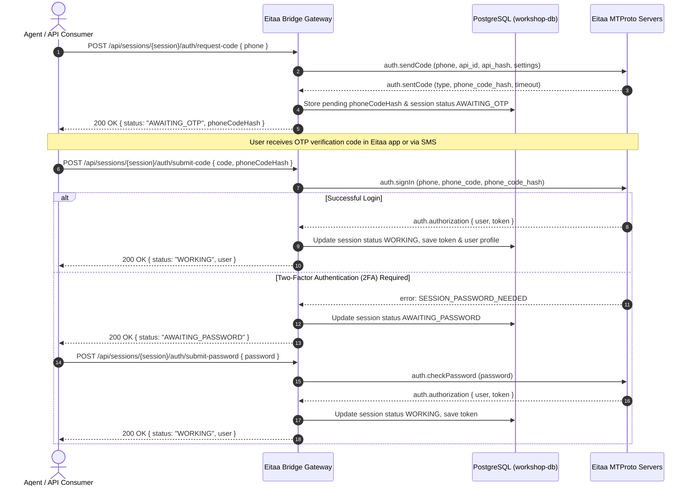

# 001-eitaa: Authentication & Login Specification

This document details the verified authentication flow, cryptographic credentials, state transitions, and live verification evidence for the Eitaa platform bridge.

---

## 1. Platform Credentials & MTProto Parameters

Live extraction and reverse-engineering of Eitaa's production web client confirmed the official MTProto parameters:

- **Target MTProto Layer**: Layer 133
- **Official API ID**: `1025907`
- **Official API HASH**: `452b0359b988148995f22ff0f4229750`
- **Production Server Pool**: 10 endpoints (`https://hasan.eitaa.ir/eitaa/`, `https://hosna.eitaa.com/eitaa/`, `https://armita.eitaa.com/eitaa/`, etc.)
- **Device IMEI Format**: 20-character string ending in suffix `__web`, generated deterministically from phone number hash and timestamp.
- **Transport Session Affinity**: Sticky server binding per session (requests for code, code submission, and operational calls must route to the same edge endpoint to preserve session cache).

---

## 2. Authentication State Machine & Flow

---

## 3. Raw Verification Evidence

End-to-end interactive authentication was executed and verified live against Eitaa's production server pool using `projects/001-eitaa/scripts/test-login.js`:

1. **Request Code (`auth.sendCode`)**:
   - Request dispatched to Eitaa MTProto server with official API ID and Hash.
   - Outcome: Received live `auth.sentCode` predicate with `auth.sentCodeTypeApp` (length: 5) and `phone_code_hash`.
2. **Submit Code (`auth.signIn`)**:
   - Submitted 5-digit verification code with sticky server routing.
   - Outcome: Received live `auth.authorization` predicate with valid session token (`token: "d0b5.a0397e8eff.17b54de_64924090"`) and user entity (`id: "64924090"`, `first_name: "پشتیبانی"`, `username: "konkooria_admin"`).
3. **Live Post-Login Operation Verification**:
   - Executed `users.getFullUser` with the acquired token -> Returned predicate `userFull` successfully.
   - Executed `messages.getDialogs` with the acquired token -> Returned predicate `messages.dialogsSlice` with 25 active dialogs (including real channels and groups such as "کارگاه MVP با هوش مصنوعی", "دیوار کنکوریا", "خبرگزاری تسنیم").

---

## 4. Token Refresh & Expiration Lifecycle

Eitaa user sessions use ephemeral tokens that periodically require renewal. The gateway transparently intercepts expiration signals:
- **Trigger**: Server responses returning `mt_eitaa_token_updating` or `mt_eitaa_updates_expire_token`.
- **Action**: Invokes `eitaaRefreshToken` with client build info (`v3.5`, `miti`).
- **Persistence**: Automatically commits the new `token` into the PostgreSQL `sessions` table.
- **Retry**: Re-dispatches the original failed request with the new token seamlessly without failing the agent's HTTP request.
