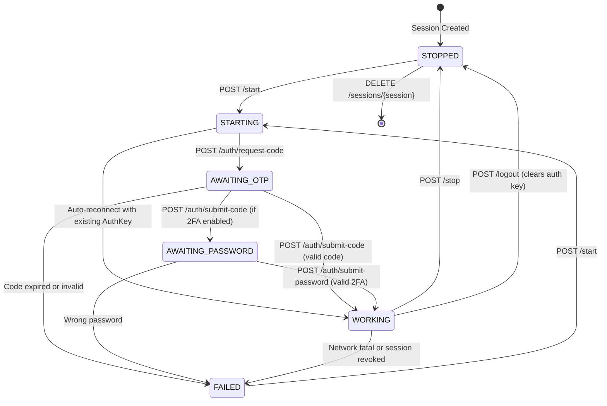

# 001-eitaa: OpenAPI Contract & Swagger Specification

This document defines the formal REST API contract, multi-session management, authentication lifecycle, chat and messaging operations, and outbound webhook event schemas for the Eitaa Bridge Gateway.

The machine-readable OpenAPI 3.0.3 specification is stored at `projects/001-eitaa/contract/openapi.json` and served dynamically by the application runtime at `/api/docs/json` with interactive Swagger UI at `/docs`.

---

## 1. Gateway Topologies & Base URLs

| Environment | Base URL | Swagger UI URL | Raw OpenAPI Spec |
| --- | --- | --- | --- |
| **Production** | `https://eitaa.api.kiloapp.ir` | `https://eitaa.api.kiloapp.ir/docs` | `https://eitaa.api.kiloapp.ir/api/docs/json` |
| **Local Dev** | `http://localhost:8016` | `http://localhost:8016/docs` | `http://localhost:8016/api/docs/json` |

---

## 2. Authentication & Security Headers

Every protected endpoint accepts authorization through either header:
1. `X-Api-Key: <secret_token>`
2. `Authorization: Bearer <secret_token>`

### Access Hierarchy
- **Master Admin Key (`GLOBAL_API_KEY`)**: Authorizes all endpoints, including administrative session provisioning (`/api/sessions`). Managed via `docs/projects/001-eitaa/secrets/credentials.md`.
- **Per-Session Key**: Authorizes messaging and chat interactions scoped strictly to that `session_id` (`/api/{session}/*`).

---

## 3. Session Lifecycle State Machine



---

## 4. Endpoints Inventory

### 4.1 System & Health
- `GET /api/health`: Health status, uptime in seconds, database connection state, and engine version.

### 4.2 Multi-Session Management
- `GET /api/sessions`: Returns an array of all configured sessions and their operational status (`SessionInfo[]`).
- `POST /api/sessions`: Provision a new session instance. Accepts `{ "name": "default", "start": true, "webhookUrl": "https://..." }`.
- `GET /api/sessions/{session}`: Retrieve operational state, phone number, and authenticated user profile for a specific session.
- `POST /api/sessions/{session}/start`: Start engine for a stopped or failed session.
- `POST /api/sessions/{session}/stop`: Disconnect session network socket while preserving auth keys in PostgreSQL.
- `POST /api/sessions/{session}/logout`: Invalidate session on Eitaa servers and clear stored credentials in PostgreSQL.
- `DELETE /api/sessions/{session}`: Remove session completely from PostgreSQL storage.

### 4.3 Authentication Flow (Phone OTP & 2FA)
- `POST /api/sessions/{session}/auth/request-code`:
  - Request body: `{ "phone": "+989120000000" }`
  - Response: `{ "status": "AWAITING_OTP", "phoneCodeHash": "hash_str", "isCodeSent": true, "timeout": 60 }`
- `POST /api/sessions/{session}/auth/submit-code`:
  - Request body: `{ "code": "12345", "phoneCodeHash": "hash_str" }`
  - Response (Direct Login): `{ "status": "WORKING", "user": { "id": "1002345", "firstName": "Omid", ... } }`
  - Response (2FA Required): `{ "status": "AWAITING_PASSWORD" }`
- `POST /api/sessions/{session}/auth/submit-password`:
  - Request body: `{ "password": "Secret2FAPassword" }`
  - Response: `{ "status": "WORKING", "user": { "id": "1002345", ... } }`

### 4.4 Chats, Groups & Channels (Unified + Dedicated Endpoints)
Per confirmed decisions in Round 02, both unified `/chats` and dedicated `/channels` and `/groups` endpoints are provided:

#### Unified Chats
- `GET /api/{session}/chats`:
  - Query parameters: `type` (`all` | `direct` | `group` | `channel`), `limit` (default: 30), `offset` (default: 0).
  - Response: `{ "total": 12, "chats": [ { "id": "123456", "type": "group", "title": "Team", "unreadCount": 0, "lastMessage": {...} } ] }`
- `GET /api/{session}/chats/{chatId}`:
  - Fetches metadata for a specific user, group, or channel by numeric ID or username handle (resolving `access_hash` via PostgreSQL entity cache).

#### Dedicated Channels & Groups
- `GET /api/{session}/channels`: List only subscribed broadcast channels.
- `POST /api/{session}/channels/{channelId}/messages/text`: Publish a text broadcast to a channel.
- `POST /api/{session}/channels/{channelId}/messages/media`: Publish media (image, audio, document) with caption to a channel.
- `GET /api/{session}/groups`: List only group dialogues.
- `POST /api/{session}/groups/{groupId}/messages/text`: Post text into a group conversation.

### 4.5 Messages (Push Webhooks & Pull Polling)
Both push notifications (webhooks) and pull queries (polling) are first-class:
- `GET /api/{session}/chats/{chatId}/messages`:
  - Query parameters: `limit` (default: 20), `beforeId` (optional for backward pagination).
  - Response: `{ "chatId": "123456", "messages": [ { "id": "987", "from": "1002345", "fromMe": false, "timestamp": 1731741600, "text": "Hello" } ] }`
- `POST /api/{session}/chats/{chatId}/messages/text`:
  - Accepts numeric `chatId` or `@username`. Resolves `access_hash` from local entity cache.
  - Request body: `{ "text": "Message content", "replyToMessageId": "987" }`
  - Response: `{ "success": true, "message": { "id": "988", "timestamp": 1731741605, ... } }`
- `POST /api/{session}/chats/{chatId}/messages/media`:
  - Request body: `{ "url": "https://example.com/file.pdf", "filename": "file.pdf", "caption": "Attached file", "replyToMessageId": null }` or `{ "data": "data:image/png;base64,...", "filename": "image.png" }`
  - Response: `{ "success": true, "message": { "id": "989", "mediaType": "document", ... } }`

---

## 5. Webhook Event Envelope (Fire-and-Forget Push)

Outbound webhooks follow the WAHA standard JSON payload format, sent as fire-and-forget HTTP POST requests with header `Content-Type: application/json` and logged delivery status:

### 5.1 Session Status Change Event (`session.status`)
```json
{
  "event": "session.status",
  "session": "default",
  "timestamp": 1731741600,
  "payload": {
    "status": "WORKING",
    "me": {
      "id": "1002345",
      "firstName": "Omid",
      "phone": "+989120000000"
    }
  }
}
```

### 5.2 Incoming Message Event (`message.created`)
```json
{
  "event": "message.created",
  "session": "default",
  "timestamp": 1731741605,
  "payload": {
    "id": "987654",
    "chatId": "12345678",
    "from": "1002345",
    "fromMe": false,
    "timestamp": 1731741605,
    "text": "Hello from customer",
    "mediaType": null,
    "replyToMessageId": null
  }
}
```

---

## 6. PostgreSQL Relational Persistence

In accordance with Round 01 & Round 02 decisions, session auth keys, peer entity access hashes, and synchronization diffs are backed by PostgreSQL (`workshop-db`):

- **`sessions` table**:
  - `name` (VARCHAR PRIMARY KEY): Session identifier.
  - `status` (VARCHAR): Current lifecycle state.
  - `phone` (VARCHAR): Logged-in phone number.
  - `auth_key` (BYTEA): Persisted MTProto / platform cryptographic authorization key.
  - `server_salt` (BIGINT): DC salt for MTProto sequence numbers.
  - `webhook_url` (TEXT): Configured outbound webhook endpoint.
  - `config` (JSONB): Engine options, forward proxy settings, and metadata.
  - `created_at`, `updated_at` (TIMESTAMPTZ).

- **`entities` table (Access Hash Cache)**:
  - `session_name` (VARCHAR REFERENCES sessions): Scoped session owner.
  - `entity_id` (BIGINT): Raw platform numeric peer ID.
  - `access_hash` (BIGINT): Cryptographic access hash required by MTProto to address this peer.
  - `entity_type` (VARCHAR): `'user'`, `'chat'`, or `'channel'`.
  - `username` (VARCHAR): Public `@username` handle (indexed for handle-to-ID lookup).
  - `phone` (VARCHAR): Phone number if contact.
  - `title` (TEXT): User display name or channel/group title.
  - `updated_at` (TIMESTAMPTZ).
  - *Primary Key*: `(session_name, entity_id)`.

- **`sync_diffs` table**:
  - `session_name` (VARCHAR REFERENCES sessions): Owner session.
  - `pts` (INTEGER): Persistent timeline sequence (PTS) counter.
  - `date` (INTEGER): Timestamp of synchronization checkpoint.
  - `qts` (INTEGER): Secret chat sequence counter.
  - `seq` (INTEGER): General sequence number.
